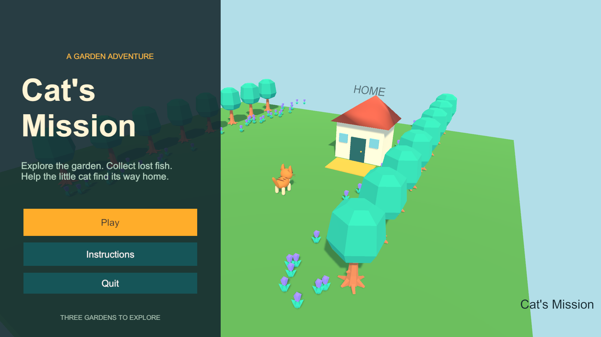
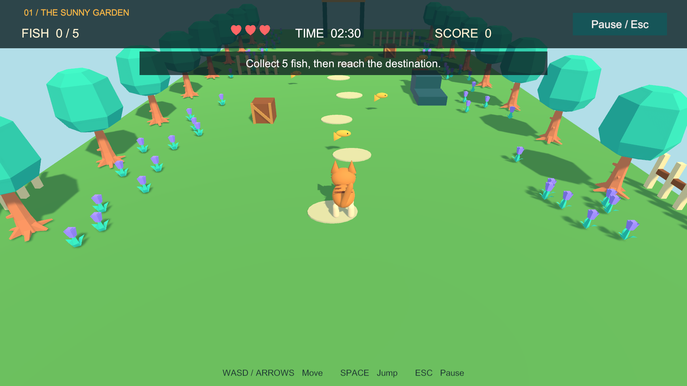
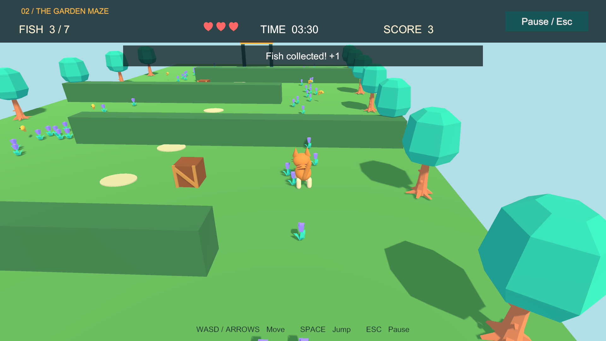
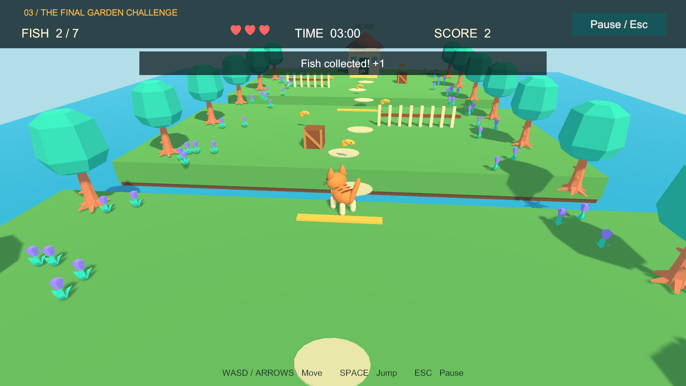
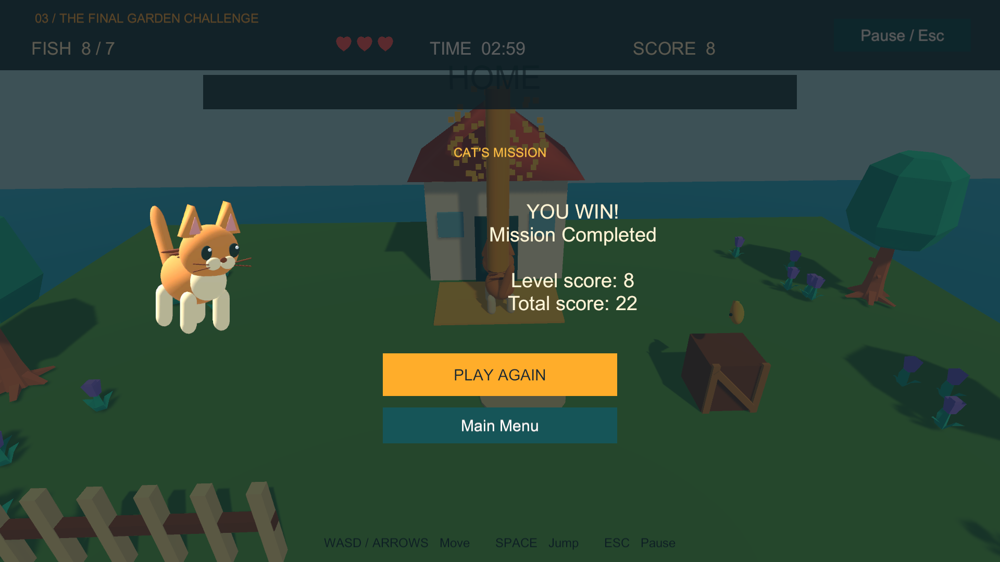

# Cat’s Mission

A single-player Unity 3D platformer about helping Miso collect lost fish and find the way home through three gardens.

  

## Explore the gardens

Follow the garden paths, find extra fish and time your jumps. Each area brings a different route on the way home.

<table>
  <tr>
    <th width="50%">The Sunny Garden</th>
    <th width="50%">The Garden Maze</th>
  </tr>
  <tr>
    <td></td>
    <td></td>
  </tr>
  <tr>
    <td>Learn the controls and explore an open garden.</td>
    <td>Find the openings between the hedges and choose a route.</td>
  </tr>
  <tr>
    <th>The Final Garden Challenge</th>
    <th>Mission Completed</th>
  </tr>
  <tr>
    <td></td>
    <td></td>
  </tr>
  <tr>
    <td>Cross the gaps and reach Miso’s home.</td>
    <td>Finish all three gardens and see your campaign score.</td>
  </tr>
</table>

All images above are screenshots from the running Unity game.

## Project files

This repository contains the editable Unity project, the final report, the presentation and test evidence. It does not contain a ready-to-run Mac application.

## Open the project on Windows or Mac

1. Download the repository with **Code > Download ZIP**, then extract it. For this private repository, the owner must invite your own GitHub account first. Alternatively, use the source ZIP supplied by the owner.
2. Install Unity Hub and the Unity Editor for **your own operating system**. The project was created with **2022.1.24f1**. Use the compatible patched **2022.1.25f1** editor for the handover rather than the vulnerable older runtime.
3. In Unity Hub, choose **Add > Add project from disk** and select the extracted folder that contains `Assets`, `Packages` and `ProjectSettings`.
4. Let Unity import the assets and restore its packages. The first import needs time and may need an internet connection.
5. Open `Assets/CatsMission/Scenes/MainMenu.unity`, then press **Play** in Unity.

The same source project can be opened in a compatible Unity Editor on Windows or macOS. An `.exe` build is for Windows and does not run natively on a Mac. Opening this project in Unity is different from running a standalone game.

## Controls and rules

- **WASD / arrow keys:** move
- **Space:** jump
- **Esc:** pause or resume
- **Mouse:** select menu buttons

Collect the required fish and reach the destination before time runs out. Each fish gives one point. Falling costs one life and returns Miso to the level start. Losing all three lives or running out of time opens Game Over. Retry resets the current level. Complete all three gardens to win.

| Level | Fish required | Fish available | Time |
| --- | ---: | ---: | ---: |
| The Sunny Garden | 5 | 7 | 150 seconds |
| The Garden Maze | 7 | 9 | 210 seconds |
| The Final Garden Challenge | 7 | 9 | 180 seconds |

## Run without installing Unity

A player needs a standalone build made for her operating system:

- **Windows:** send the complete build folder in one ZIP, including `CatsMission.exe`, `CatsMission_Data` and the neighbouring runtime files. Sending only the EXE is insufficient.
- **macOS:** create and test a separate Mac build. Mac Build Support is needed on the machine that exports that build. Choose the architecture appropriate to the recipient’s Mac, or a universal build supporting Intel and Apple silicon.

The current local Windows evaluation build used Unity 2022.1.24f1. It is excluded from this repository. Rebuild with a compatible patched editor before external distribution to address CVE-2025-59489. No Mac build has been produced or verified yet.

## Scenes and source files

- `Assets/CatsMission/Scenes`: MainMenu, Level1, Level2 and Level3.
- `Assets/CatsMission/Scripts`: gameplay, game state, camera, interface and audio.
- `Assets/CatsMission/Prefabs`: reusable project assets.
- `Assets/CatsMission/Tests`: EditMode and PlayMode tests.
- `Packages` and `ProjectSettings`: package dependencies and Unity project configuration.
- `Docs/ASSET-CREDITS.md`: external asset sources and retained licenses.
- `Docs/Testing`: saved test results, build log and screenshots.

`Library`, `Temp`, `Logs`, `UserSettings`, local backups and authoring drafts are intentionally excluded. Unity recreates its generated folders when the source project opens.

## Report and presentation

- [Final report](Deliverables/CatsMission_Submission_Report.docx)
- [Presentation](Deliverables/CatsMission_Team_Alignment.pptx)

The presentation has 15 slides with speaker notes, five slides and about four minutes per student. Use PowerPoint’s Slide Show mode to see the transitions and entrance effects.

## Validation

The saved results contain **10 passing EditMode tests** and **15 passing PlayMode tests**. The PlayMode suite includes a scripted route through all three gardens using production movement and real colliders and triggers. These results do not replace human difficulty testing or verification on the recipient’s Mac.

Run the tests through **Window > General > Test Runner**. The saved result files are `Docs/Testing/report-edit-evidence-01.xml` and `Docs/Testing/report-images-play-01.xml`.

## للطالبات

**للتعديل أو تجربة المشروع داخل Unity:** نزّلي ملفات المشروع وفكّي الضغط، ثم افتحي المجلد الذي يحتوي على `Assets` و`Packages` و`ProjectSettings` من Unity Hub. بعد اكتمال الاستيراد، افتحي مشهد `MainMenu` واضغطي Play. على جهاز الماك، ثبّتي Unity المخصّص للماك، وليس مُثبّت Windows.

**للعب مباشرة دون Unity:** تحتاجين نسخة مبنية لنظام جهازك. ملف Windows بصيغة `.exe` لا يعمل مباشرة على الماك. نسخة الماك لم تُجهّز بعد، ورفع المشروع إلى GitHub لا يحوّله تلقائيًا إلى نسخة ماك أو لعبة تعمل في المتصفح.

## References

- [Downloading a source ZIP from GitHub](https://docs.github.com/en/repositories/working-with-files/using-files/downloading-source-code-archives)
- [Unity 2022.1.25f1 release notes](https://unity.com/releases/editor/whats-new/2022.1.25f1)
- [Unity macOS build documentation](https://docs.unity3d.com/2022.1/Documentation/Manual/macos-building.html)
